# Dev7c — Docker Compose, Service Networking & Persistent MongoDB Data

**Orchestrating Python Girls That Code with a Nexus-hosted FastAPI image, MongoDB, Mongo Express, health-aware startup and durable Docker volumes**

    

> **Project lineage:** [Dev7a — Dockerising Python Girls That Code](https://github.com/ChiomaScripts/Dev7a-docker-python) → [Dev7b — Private Docker Registry with Nexus](https://github.com/ChiomaScripts/Dev7b-docker-nexus-registry) → **Dev7c — Docker Compose & Persistent Data (this repository)**.
>
> This repository holds the orchestration configuration, safe environment template and implementation evidence. **The application source code and Dockerfile remain in Dev7a; the registry implementation remains in Dev7b.** No duplicate application code is required.

---

## 01 — Executive Summary

In Dev7a, I manually created and connected Docker containers for my Python Girls That Code FastAPI CRUD application, MongoDB and Mongo Express. In Dev7b, I published the application image to a self-hosted Sonatype Nexus Docker registry on a DigitalOcean server. Dev7c brings those two projects together: **a single declarative Compose file launches the existing image and its supporting services as one application stack**.

Two objectives here: replace repetitive `docker run` commands with reproducible service definitions, and ensure MongoDB data outlives the containers that use it. It also became a practical investigation into the distinction between *internal container ports*, *published Windows host ports* and *Compose's automatic service-name networking*.

**Verified outcome:** The uploaded learning evidence shows Compose creating and starting the stack, the FastAPI interface loading on `localhost:8001`, Mongo Express serving its interface on `localhost:8083`, and user records remaining available after stopping/bringing down and recreating the stack. The later evidence includes a newly created second profile alongside the original record. See the implementation and validation screenshots below.

### Project at a glance

| Dimension | Implementation |
|---|---|
| Orchestration | Docker Compose, three services |
| Application | Existing FastAPI image `python-girls-that-code:1.0` |
| Image distribution | Private Nexus Docker registry, `159.89.153.232:8082` |
| Database | MongoDB, internal port `27017` |
| Database administration | `techworldwithnana/mongo-express`, internal port `8081` |
| Host access | FastAPI `8001:8000`; Mongo Express `8083:8081`; MongoDB `27018:27017` in the **tested** YAML |
| Service discovery | Compose-created default network, `mongodb` DNS name |
| Persistence | Named Docker volume `chioma-mongo-data` mounted at `/data/db` |
| Runtime configuration | `.env.docker` via service-level `env_file:` |
| Startup coordination | MongoDB health check and `depends_on: condition: service_healthy` |
| Recovery policy | `restart: unless-stopped` |

---

## 02 — Problem, Objectives and Architecture

### The problem with manually managed containers

Manual Docker commands are useful for understanding images, networks, port mappings and volumes individually. However, the same three-service application becomes harder to reproduce when its setup is spread across separate `docker run` commands. A database container might start before the application, a service might use the wrong network or credentials, and a new database container without persistent storage could lose application records when removed.

Compose provides a **declarative description of the desired multi-container application**. Instead of remembering each command, I define services, images, environment sources, port bindings, dependencies and storage in `docker-compose.yaml`, then manage them together.

### Architecture

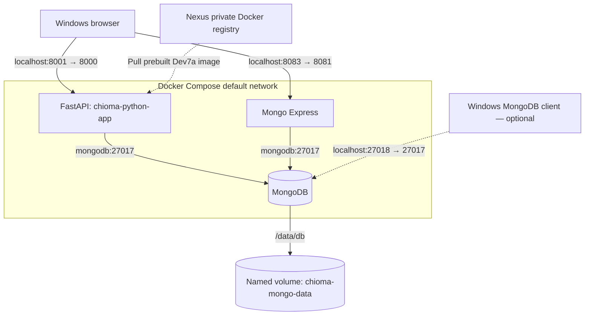

**The two UIs serve different purposes.** FastAPI serves the application frontend and handles profile CRUD requests; Mongo Express is a separate administrative interface that inspects MongoDB directly. Neither UI runs as a desktop browser *inside* its container. The web servers run in containers, while the browser runs on Windows.

### Repository layout

```text
Dev7c-docker-compose-volumes/
├── README.md
├── docker-compose.yaml
├── .env.example
├── .gitignore
└── assets/
    └── screenshots/
        ├── SCREENSHOT-MAP.md
        └── *.png
```

`.env.docker` is deliberately absent from version control because it contains local credentials.

---

## 03 — Learning Investigation: Ports, Networks and Container Identity

This project began with a question: **If Compose automatically connects the services, do I need to publish any ports at all?** The answer became clearer once I separated three independent concerns.

1. **Application listening port:** MongoDB listens on its configured port inside its container (normally `27017`); Mongo Express normally uses `8081`; the FastAPI image used `8000` in this deployment.
2. **Internal container communication:** Compose creates a default network and provides DNS for service names. FastAPI and Mongo Express reach the database at `mongodb:27017`, without using Windows host port `27018`.
3. **Host publishing:** `HOST_PORT:CONTAINER_PORT` makes a containerised service reachable through a Windows host interface. `8001:8000` exposes FastAPI to my browser; `8083:8081` exposes Mongo Express. MongoDB's `27018:27017` mapping was retained in the **actual uploaded Compose configuration**, although it is not needed for the other two services to reach MongoDB.

### Why multiple MongoDB containers can all listen on 27017

Each container has its own network namespace and IP address. Two MongoDB containers may therefore both listen on their own internal `27017`; they conflict only if both attempt to bind the **same host IP and host port**. For example, one could publish `27016:27017` and another `27015:27017`. The host-side numbers differ; the application-side number need not.

**Important nuance:** An `EXPOSE` declaration or `27017/tcp` in `docker ps` is not the same as a host-published mapping such as `0.0.0.0:27018->27017/tcp`. A container can also listen on an internal port without that port being listed in Docker metadata.

### Finding ports configured on stopped Dev7a containers

I initially inspected Windows listening ports from Git Bash:

```bash
netstat -ano | grep LISTENING
netstat -ano | grep LISTENING | grep ':8000 '
```

These commands only show sockets **currently listening**. They did not answer my real question because the old FastAPI and other Dev7a containers were stopped. I needed to discover **configured Docker port bindings**, even for stopped containers.

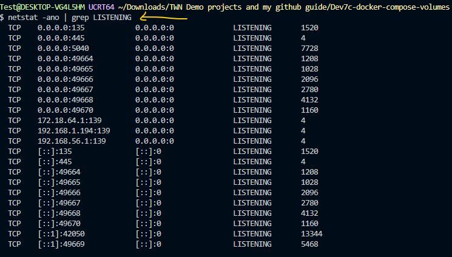

*Evidence — notes page 5: checking active Windows listeners. This was useful, but insufficient for stopped containers.*

I next tried:

```bash
docker ps -a --format "table {{.Names}}\t{{.Status}}\t{{.Ports}}"
```

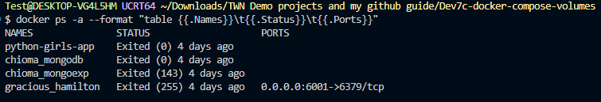

*Evidence — notes page 6: stopped containers were listed, but their published host-port mappings were not reliably displayed.*

The breakthrough was inspecting each container's saved `HostConfig.PortBindings`:

```bash
for container in $(docker ps -aq); do
    docker inspect "$container" \
        --format '{{.Name}} -> {{json .HostConfig.PortBindings}}'
done
```

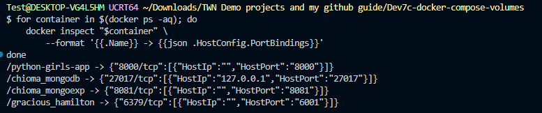

*Evidence — notes page 6: the inspect loop revealed the old host-to-container mappings and informed the new Compose port choices.*

This taught me a distinction I will reuse: **configured** does not mean **currently occupied**. A stopped container retains its port configuration but ordinarily does not hold an active host listener. Starting it later can still conflict with another running service that has claimed the same binding. I chose distinct host ports for Dev7c to keep the environments separate.

### Service names versus container names

I considered setting `container_name` explicitly. I ultimately left it out: Compose can generate project-scoped names and resolves services by the YAML keys (`mongodb`, `mongo-express`, `chioma-python-app`). For inter-service connections, use `mongodb`, **not** a legacy Dev7a container name such as `chioma_mongodb` and not `localhost`. Within the FastAPI container, `localhost` means that container itself.

---

## 04 — Prerequisites and Environment Preparation

The tested workflow used Docker Desktop on Windows with Git Bash, the previously built Dev7a FastAPI image, and the Dev7b Nexus Docker registry hosted on DigitalOcean. A local Docker Engine, Docker Compose plugin and network access to the registry are required.

The image is referenced as:

```text
159.89.153.232:8082/python-girls-that-code:1.0
```

Before launching Compose, I **started the Nexus service** on the remote server so Docker could obtain the prebuilt FastAPI image if it was not already available locally.

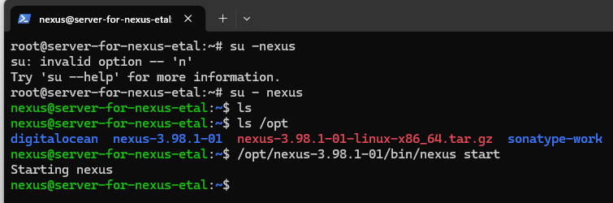

*Evidence — notes page 7: starting the Nexus service before deployment.*

For a remote registry, Docker may also require `docker login`, and the client must be configured to permit this lab's HTTP registry if applicable. HTTP/insecure-registry configuration is **lab-specific**, not a recommended production deployment posture. Prefer HTTPS/TLS, appropriate credentials and a protected registry in real environments.

### Preparing the repository

```bash
mkdir -p Dev7c-docker-compose-volumes
cd Dev7c-docker-compose-volumes
cp .env.example .env.docker
```

Replace the placeholders in `.env.docker` with local lab values. **Do not commit this file**. Ensure the MongoDB password is consistent across the initialisation variable and both MongoDB URLs; if a password contains URI-reserved characters, URL-encode it in the connection strings.

---

## 05 — Implementing the Three-Service Compose Stack

The repository's [`docker-compose.yaml`](docker-compose.yaml) is a cleaned-up, commented version of the **uploaded, successfully tested** service configuration. It preserves all active settings, including MongoDB's published `27018:27017` mapping, rather than replacing them with an untested alternative.

### FastAPI: reuse the Nexus artifact

```yaml
chioma-python-app:
  image: 159.89.153.232:8082/python-girls-that-code:1.0
  ports:
    - "8001:8000"
  env_file:
    - .env.docker
  depends_on:
    mongodb:
      condition: service_healthy
  restart: unless-stopped
```

`image:` instructs Compose to run the existing image. There is no `build:` instruction and no copy of the FastAPI source in this repository. `ports:` exposes the application to Windows; `env_file:` supplies the MongoDB connection string; `depends_on:` delays startup until MongoDB passes its health check.

### MongoDB: credentials, host binding and persistence

```yaml
mongodb:
  image: mongo
  ports:
    - "27018:27017"
  env_file:
    - .env.docker
  volumes:
    - chioma-mongo-data:/data/db
```

`27018:27017` was the **actual lab mapping**. It allows direct host-based MongoDB client access, but is not needed for internal FastAPI or Mongo Express traffic. In a tighter deployment, I could omit it entirely or bind it to loopback only.

`chioma-mongo-data:/data/db` is a **named-volume mount**, not a Windows folder path. Docker manages the volume's underlying storage; `/data/db` is MongoDB's data directory **inside the container**. The top-level `volumes:` declaration defines the named volume, with the default `local` driver explicitly specified in this project.

The official MongoDB image uses `MONGO_INITDB_ROOT_USERNAME` and `MONGO_INITDB_ROOT_PASSWORD` to initialise credentials **when the database directory is empty**. Changing these variables later does not automatically update credentials in an existing persisted database.

### Mongo Express: separate administrative UI

```yaml
mongo-express:
  image: techworldwithnana/mongo-express
  ports:
    - "8083:8081"
  env_file:
    - .env.docker
  depends_on:
    mongodb:
      condition: service_healthy
  restart: unless-stopped
```

Mongo Express uses its MongoDB URL to connect to `mongodb:27017` on the internal network. Its separate browser-facing authentication settings protect access to the administration UI in this lab. The uploaded screenshots confirm the interface was accessible; image-specific environment support should be rechecked when upgrading or replacing the `techworldwithnana/mongo-express` image.

---

## 06 — Runtime Environment Variables: Docker Run vs Compose

An important conceptual milestone was realising that Compose **does** have an equivalent to `docker run --env-file .env.docker`:

```yaml
env_file:
  - .env.docker
```

This injects the file's key-value pairs into the **container environment when the service is created**. By contrast, the CLI command `docker compose --env-file .env.docker up -d` primarily supplies variables for **Compose-file interpolation**, such as `${VARIABLE}`; it does not automatically inject every variable into every container. The two features solve different problems.

The uploaded `.env.docker` uses the following keys (real values are intentionally excluded from this repository):

| Key | Consumer / purpose |
|---|---|
| `MONGO_INITDB_ROOT_USERNAME` | MongoDB initial root account |
| `MONGO_INITDB_ROOT_PASSWORD` | MongoDB initial root password |
| `MONGO_URI` | FastAPI's MongoDB connection string |
| `ME_CONFIG_MONGODB_URL` | Mongo Express's MongoDB connection string |
| `ME_CONFIG_BASICAUTH_USERNAME` | Mongo Express web login |
| `ME_CONFIG_BASICAUTH_PASSWORD` | Mongo Express web login password |

The Dev7a Python source also supports `MONGO_DB_NAME` and `MONGO_COLLECTION_NAME`, defaulting to `user-account` and `users`. These optional keys are included in [`.env.example`](.env.example) for clarity. The uploaded Dev7c environment file did **not** explicitly set them, so the Dev7a application defaults were relevant.

**Why FastAPI needs the URI:** The browser sends a `POST /profiles` to create a coder, or `GET /profiles` to list coders. FastAPI then performs MongoDB operations through its PyMongo client. Its `database.py` reads `os.environ["MONGO_URI"]`, which means the Compose-injected value supplies the host, port and authentication details without rebuilding the image. Other CRUD operations include `GET`, `PUT` and `DELETE` on `/profiles/{profile_id}`.

**Security consideration:** In the tested configuration, the same `.env.docker` is injected into all three services. This works, but grants each container more environment data than it needs. A production-minded improvement is to use **service-specific environment files or secrets**, avoid publishing database ports unnecessarily and use credentials with limited database privileges. Environment variables are not encrypted secret storage.

---

## 07 — Health Checks, Startup Dependencies and Restart Policies

### Why a health check was added

A started container is not necessarily a **ready database**. MongoDB may still be initialising its data files and accepting connections. A plain `depends_on: [mongodb]` coordinates startup order, but does not wait for database readiness. I therefore added a MongoDB health check and set both dependent services to wait for `condition: service_healthy`.

```yaml
healthcheck:
  test:
    - CMD-SHELL
    - mongosh --quiet --eval "db.adminCommand('ping').ok" | grep -q 1
  interval: 10s
  timeout: 5s
  retries: 10
  start_period: 30s
```

| Setting | What it does | Why it matters |
|---|---|---|
| `healthcheck` | Declares a periodic container health test | Tests service responsiveness rather than mere process existence |
| `CMD-SHELL` | Runs the test through a shell **inside MongoDB's container** | Allows the pipe to `grep` |
| `mongosh --quiet --eval ...` | Runs a MongoDB `ping` command and prints its `.ok` value | A simple responsiveness signal |
| `grep -q 1` | Quietly succeeds if the output contains `1` | Supplies an exit code Docker interprets as success/failure |
| `interval: 10s` | Schedules checks at roughly ten-second intervals | Rechecks health periodically |
| `timeout: 5s` | Fails a check if it takes too long | Avoids hanging checks |
| `retries: 10` | Allows ten consecutive counted failures before `unhealthy` | Tolerates temporary failures |
| `start_period: 30s` | Gives MongoDB an initial grace period for failures | Accommodates startup work |

**Limitations:** This is a lightweight readiness probe, not an authenticated end-to-end check of the application's database access. The string match is also simplistic; a more robust probe would rely on an unambiguous command exit status. `depends_on: service_healthy` gates initial startup; it does **not** continuously restart FastAPI or Mongo Express if MongoDB becomes unhealthy later.

### Why `restart: unless-stopped` rather than `always`?

Both policies restart a container after unexpected process exit, once Docker's restart-policy conditions are met. The difference matters when a developer **deliberately stops** a container: `unless-stopped` respects that stop even across Docker daemon restarts, whereas `always` can restart a previously manually stopped container when the daemon restarts. I used `unless-stopped` for a lab I intentionally shut down between sessions.

**Correction to an early working note:** A restart policy does not inherently mean “Mongo Express keeps restarting until it connects to MongoDB,” nor does an `unhealthy` result alone trigger Docker's restart policy. The process must exit for the restart policy to act. The health-gated `depends_on` is the mechanism used here to coordinate initial readiness.

---

## 08 — Deployment and Verification

### Launch the stack

From the directory containing `docker-compose.yaml`:

```bash
# Check the Compose file without starting containers.
docker compose config --quiet

# Start services in detached mode.
docker compose up -d

# See the Compose project containers and their status.
docker compose ps

# Inspect logs when investigating startup or connectivity.
docker compose logs
```

Because the file was named `docker-compose.yaml` and the command ran from the project directory, the `-f` argument was unnecessary. For another filename or directory, use `docker compose -f path/to/file.yaml ...`.

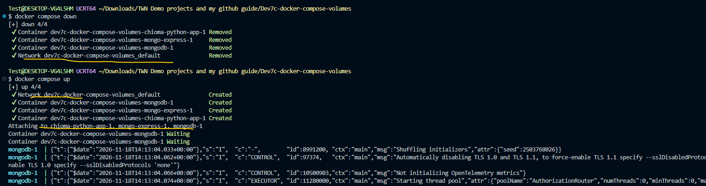

*Evidence — notes page 7: initial Compose startup and service-status output.*

### Verify the application UI

With the published port mapping, the Python Girls That Code frontend was accessible at **`http://localhost:8001`**. The screenshot shows the profile form and an initial coder record.


*Evidence — notes page 8: FastAPI application running from the Nexus-hosted image under Compose.*

### Verify Mongo Express access and records

Mongo Express was accessible at **`http://localhost:8083`**. The evidence captures both the browser login prompt and the `user-account` database's `users` collection.

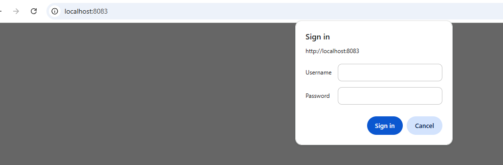

*Evidence — notes page 9: Mongo Express browser authentication.*

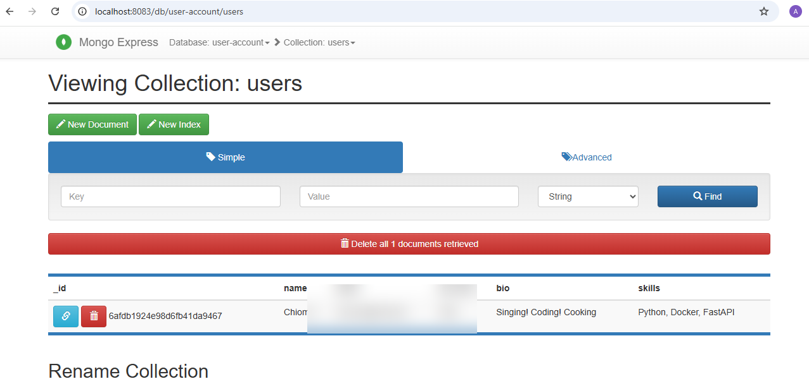

*Evidence — notes page 9: initial database record visible through the administration UI; email field obscured in the published evidence.*

The combined evidence demonstrates two distinct paths to the same database: the FastAPI application's CRUD API and Mongo Express's administrative interface.

---

## 09 — Persistence Test: Destroy the Stack, Keep the Data

A successful UI load alone would not prove persistence. The important test was whether MongoDB records would survive the Compose stack being stopped and recreated.

### Test procedure and observation

1. Created a coder profile using the application and confirmed it appeared in Mongo Express.
2. Stopped/brought down the Compose application, then started it again.
3. Observed the services restarting and the application accepting connections.
4. Added a second profile and checked that the original record **still existed** alongside it.

My notes specifically record that `docker compose down` removes the Compose-created network, which is recreated on the next `up`. **By default, `down` does not delete named volumes.** That is the key reason the records could survive recreation of the containers and network.

```bash
# Stop and remove the Compose containers and project network.
docker compose down

# Recreate and start the stack using the same named volume.
docker compose up -d

# Inspect logs after restart.
docker compose logs

# Check the named volume (actual name may include a Compose project prefix).
docker volume ls
```

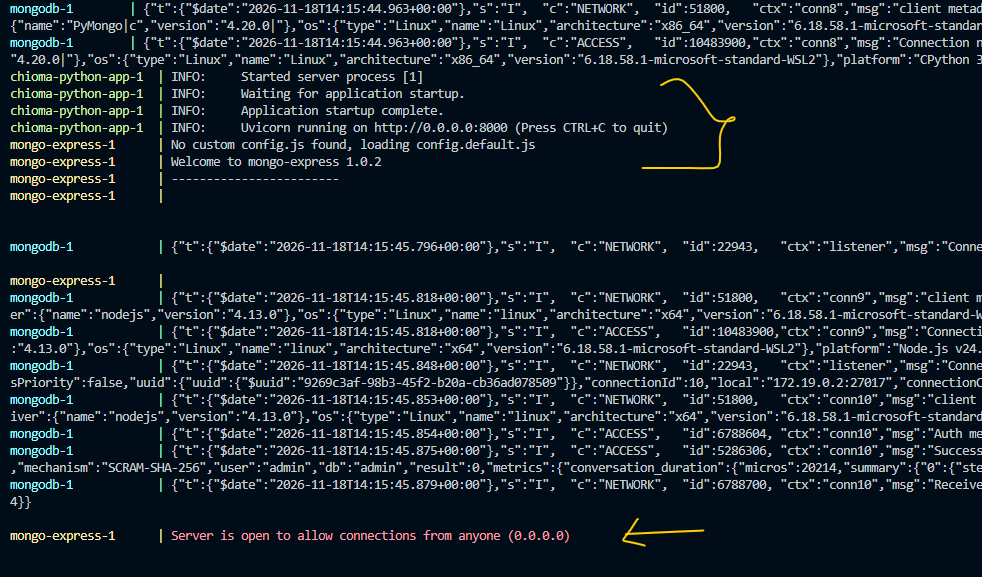

*Evidence — notes page 10: application and supporting service logs during the restart/persistence exercise.*

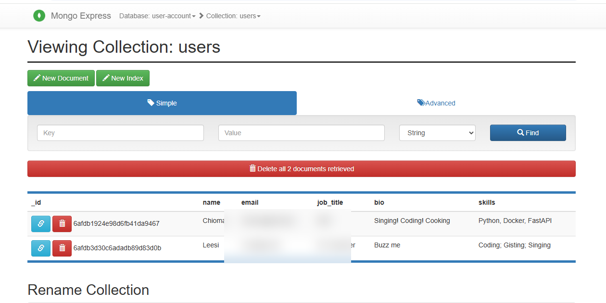

*Evidence — notes page 10: the `users` collection shows both the original profile and a second profile after restart; email fields obscured.*

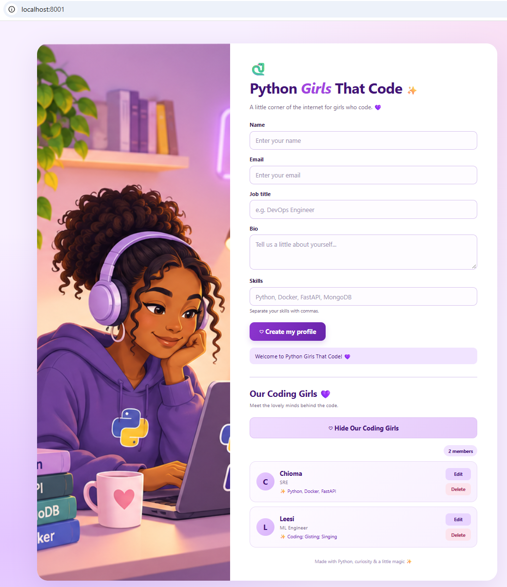

*Evidence — notes page 11: the application UI also shows two coder profiles after the persistence test.*

### Why this works

Containers are replaceable compute instances; their writable layers should not be the sole home for important database state. A named volume is managed independently of the container lifecycle. When a replacement MongoDB container mounts the same `chioma-mongo-data` volume at `/data/db`, it sees the stored database files.

**Caution:** `docker compose down -v` explicitly removes Compose-managed named volumes and can delete the database state. Do not use `-v` when testing preservation of records. A named volume also does not replace proper database backups, retention policies or disaster recovery.

---

## 10 — Troubleshooting, Investigations and Engineering Decisions

| Situation | What I investigated or changed | Outcome / interpretation |
|---|---|---|
| Unsure whether to publish all three service ports | Distinguished internal container networking from Windows host access | Published the two UIs; the tested YAML also retained an optional MongoDB host mapping |
| Windows `netstat` showed no relevant listener | Checked active TCP listeners in Git Bash | Insufficient to discover mappings of stopped containers |
| `docker ps -a` omitted useful port mappings | Queried `HostConfig.PortBindings` using `docker inspect` in a Bash loop | Found the old Dev7a configured host ports and selected alternative Dev7c ports |
| Unsure whether to declare a custom network | Reviewed Compose's default network and service DNS | Relied on the automatically created network and `mongodb` hostname |
| Concerned that the database might start slowly | Added a MongoDB health check and `service_healthy` dependencies | Implemented startup readiness gating; the uploaded evidence shows the stack ran successfully |
| Concerned about data loss on recreation | Mounted `chioma-mongo-data` at `/data/db` | Observed records retained after teardown and restart |
| FastAPI image hosted remotely | Started the existing Nexus service before launching the stack | Successfully launched the application in the Compose deployment |

**Accuracy note:** The learning notes do not document a failed Compose deployment or a proven runtime root-cause incident. The main troubleshooting story here is an **investigation of port visibility and configuration**, followed by a successful deployment and persistence test. No additional failure or resolution is inferred.

---

## 11 — Key Lessons and Production Considerations

### What I learned hands-on

- **Port publishing is not the same as container communication.** Containers can be running and communicating while remaining inaccessible via Windows `localhost`.
- **Compose provides service discovery.** Service names such as `mongodb` are internal DNS hostnames; explicit container names are unnecessary for this project.
- **Stopped containers retain configuration.** `docker inspect` exposes saved port bindings that may not appear in `docker ps` output.
- **The same image can run in a new environment.** The Dev7a application was reused without duplicating or rebuilding its source; Compose supplied its runtime database URL.
- **A ready service is different from a started container.** Health checks improve initial dependency coordination, with clearly understood limits.
- **Data persistence requires storage outside the container writable layer.** The named-volume test demonstrated survival across Compose teardown and recreation.
- **Compose turns imperative steps into versioned configuration.** A single file records the application topology, while a separate untracked file supplies local environment values.

### Improvements to consider beyond this completed lab

These are **recommendations, not claims of implemented work**:

1. **Reduce exposure:** Omit the MongoDB host port if host-based clients are unnecessary; bind local-only UIs to `127.0.0.1` where appropriate.
2. **Separate credentials:** Give each service only the variables it needs; use dedicated database users and a secret-management solution instead of sharing the root password.
3. **Secure the registry:** Replace the lab HTTP connector with TLS and avoid hardcoding a public IP address into long-lived deployments.
4. **Pin image versions or digests:** `mongo` without a tag can resolve to different versions over time. Record compatible versions for reproducibility.
5. **Improve readiness and observability:** Use a robust MongoDB health probe and consider application-specific checks, structured logs and monitoring.
6. **Test resilience more thoroughly:** Verify behaviour under database unavailability, unexpected process exit, host reboot and restore from backup.
7. **Add CI validation:** Automate Compose syntax checks and secret scanning before publishing changes.

---

## 12 — Reproducing the Lab Safely

```bash
# 1. Clone the repository and enter it.
git clone https://github.com/ChiomaScripts/Dev7c-docker-compose-volumes.git
cd Dev7c-docker-compose-volumes

# 2. Create local configuration (never commit it).
cp .env.example .env.docker
# Edit .env.docker with your lab credentials.

# 3. Confirm Docker can access the private Nexus image.
# If needed, authenticate and start the remote registry first.

# 4. Validate and launch.
docker compose config --quiet
docker compose up -d

# 5. Verify the services and browse the UIs.
docker compose ps
# FastAPI:      http://localhost:8001
# Mongo Express: http://localhost:8083

# 6. Stop without removing named volumes.
docker compose down
```

The image is hosted on a **private, lab-managed registry** and may not be publicly accessible or continuously online. This README documents the completed implementation; cloning the repository alone does not guarantee the remote registry is available to third parties. The included `.env.example` contains placeholders, not functioning credentials.

---

## 13 — Evidence Index and Screenshot Provenance

All evidence images below were **extracted from the supplied learning-notes document**, not recreated. The first three instructional write-up screenshots are intentionally omitted; their useful concepts are incorporated into the explanatory sections instead.

| Notes page | Position | Evidence filename | README section |
|---|---|---|---|
| 5 | Bottom | [`windows-listening-ports-git-bash.png`](assets/screenshots/windows-listening-ports-git-bash.png) | §03 Port investigation |
| 6 | Top | [`docker-ps-stopped-containers.png`](assets/screenshots/docker-ps-stopped-containers.png) | §03 Port investigation |
| 6 | Middle | [`docker-inspect-stopped-port-bindings.png`](assets/screenshots/docker-inspect-stopped-port-bindings.png) | §03 Port investigation |
| 7 | Top | [`nexus-service-started.png`](assets/screenshots/nexus-service-started.png) | §04 Prerequisites |
| 7 | Bottom | [`compose-up-and-container-status.png`](assets/screenshots/compose-up-and-container-status.png) | §08 Deployment |
| 8 | Middle | [`fastapi-first-compose-launch.png`](assets/screenshots/fastapi-first-compose-launch.png) | §08 Application validation |
| 9 | Top | [`mongo-express-browser-authentication.png`](assets/screenshots/mongo-express-browser-authentication.png) | §08 Mongo Express |
| 9 | Middle | [`mongo-express-initial-user-record.png`](assets/screenshots/mongo-express-initial-user-record.png) | §08 Mongo Express |
| 10 | Top | [`compose-restart-service-logs.png`](assets/screenshots/compose-restart-service-logs.png) | §09 Persistence test |
| 10 | Bottom | [`mongo-express-persisted-records.png`](assets/screenshots/mongo-express-persisted-records.png) | §09 Persistence test |
| 11 | Middle | [`fastapi-records-after-restart.png`](assets/screenshots/fastapi-records-after-restart.png) | §09 Persistence test |

The table is also available as [`assets/screenshots/SCREENSHOT-MAP.md`](assets/screenshots/SCREENSHOT-MAP.md). Email fields in Mongo Express evidence were obscured for publication.

---

## 14 — Project Reflection and Portfolio Navigation

Dev7c was the point at which the Docker exercises began to feel like a **connected deployment workflow**, rather than isolated commands. The port investigation was especially valuable: I moved from asking whether ports had to be declared at all to understanding which services needed external access, why two containers can use the same internal port, and how to inspect configured mappings even when containers are stopped.

The second major lesson was persistence. Running a database container is easy; showing that application records remain after its surrounding stack is torn down and recreated is a stronger demonstration of correct state management. I now have an orchestration file that expresses the topology of my application, and a documented verification trail showing the three services working together.

**Related completed projects:**

- [Dev7a — Docker for Local Development: Python Girls That Code](https://github.com/ChiomaScripts/Dev7a-docker-python) — FastAPI application source, CRUD API, Dockerfile and original local containerisation.
- [Dev7b — Private Docker Registry with Sonatype Nexus](https://github.com/ChiomaScripts/Dev7b-docker-nexus-registry) — self-hosted Nexus registry and publishing the application image.
- [Dev6 — Nexus Artifact Repository](https://github.com/ChiomaScripts/Dev6-nexus-artifact-repository) — earlier artifact-management experience.
- [Dev5 — Cloud IaaS Deployment](https://github.com/ChiomaScripts/Dev5-cloud-iaas) — earlier cloud infrastructure and application deployment.
- [DevOps Portfolio](https://github.com/ChiomaScripts/DevOps-Portfolio) · [Engineering Portfolio](https://github.com/ChiomaScripts/Engineering-Portfolio)

*Build the application. Publish the image. Orchestrate the services. Preserve the data.*
